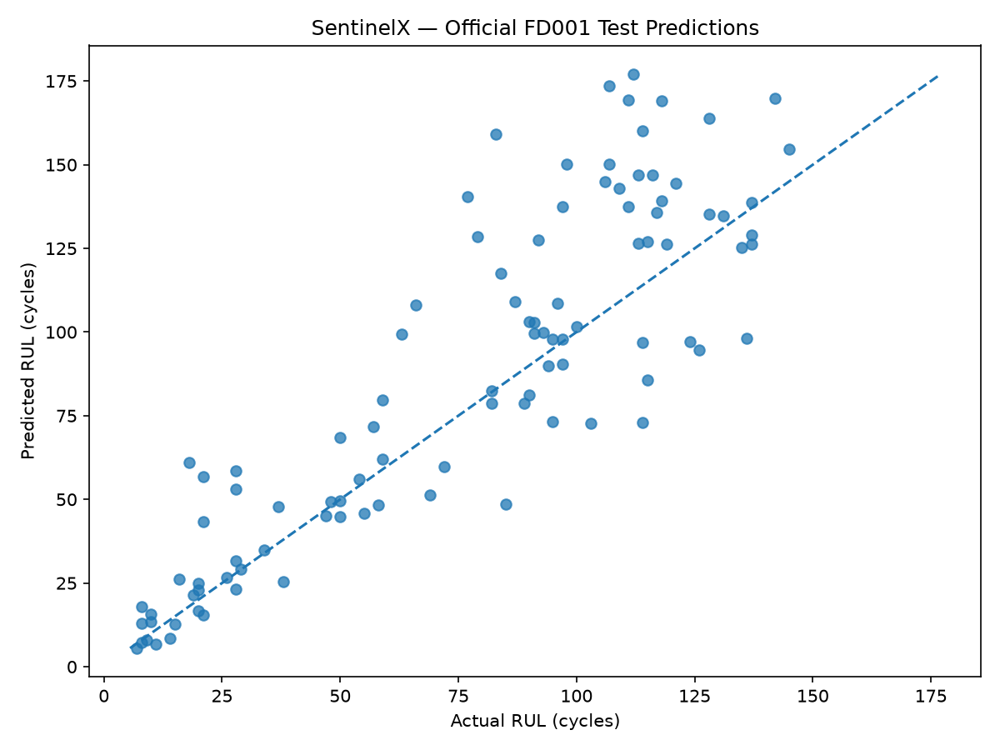

# SentinelX — Predictive Maintenance for Aircraft Engines

SentinelX is a machine learning project that estimates the **Remaining Useful Life (RUL)** of aircraft engines using sensor measurements from NASA's C-MAPSS FD001 turbofan engine degradation dataset.

It combines a LightGBM regression model for RUL prediction, SHAP-based model explanations, sensor-range validation, an Isolation Forest anomaly detector, and a FastAPI REST API.

> **Important:** SentinelX is a research and portfolio project, not a certified aircraft safety or maintenance system. Anomaly flags indicate unusual sensor patterns and do not confirm mechanical faults.

## Live Demo

- **Live API:** https://sentinelx-o4im.onrender.com
- **Interactive API documentation:** https://sentinelx-o4im.onrender.com/docs
- **Health check:** https://sentinelx-o4im.onrender.com/health

The hosted service may take around 50 seconds or more to respond after a period of inactivity. The deployed service's current availability and endpoint behavior should be verified before a demonstration.

## Key Results

### Remaining Useful Life prediction

Evaluated on the official NASA C-MAPSS FD001 test set.

| Metric | Result |
|---|---:|
| Root Mean Squared Error (RMSE) | 26.08 cycles |
| Mean Absolute Error (MAE) | 18.95 cycles |

These metrics describe the LightGBM RUL regression model's performance on FD001. They do not measure anomaly-detection performance and do not guarantee similar results on other engine configurations or real-world engines.

### Actual vs. predicted RUL



The plot compares predicted RUL with the official FD001 test-set labels.

### Anomaly detector evaluation

The Isolation Forest detector was evaluated on a reserved final-test partition of 20 engines, containing 4,010 readings. Its threshold was selected using validation data and kept fixed for final-test evaluation.

| Measure | Observed result |
|---|---:|
| Final-test engines | 20 |
| Final-test readings | 4,010 |
| Flagged readings | 114 |
| Overall flag rate | 2.84% |
| Consecutive flagged runs | 55 |
| Longest flagged run | 8 cycles |

All 114 flagged readings occurred at RUL of 30 cycles or less in this final-test partition. This is an observed association in this dataset, not proof of fault prediction or demonstrated maintenance lead time.

The evaluation dataset does not provide ground-truth anomaly labels for this analysis. Therefore, precision, recall, false-positive rate, and confirmed fault-detection accuracy cannot be claimed.

## Features

- **RUL prediction:** Estimates remaining useful life in operating cycles using LightGBM.
- **SHAP explainability:** Reports feature contributions to individual RUL predictions.
- **Sensor-range validation:** Checks readings against observed FD001 training-data ranges.
- **Anomaly detection:** Uses a saved StandardScaler and Isolation Forest pipeline to flag unusual sensor patterns.
- **REST API:** Exposes prediction, validation, explanation, and anomaly-detection endpoints through FastAPI.
- **Evaluation and analysis:** Includes model evaluation, anomaly summaries, sensor comparisons, and flagged-run analysis.
- **Docker support:** Packages the RUL API and its LightGBM model.
- **Automated tests:** Tests API behavior and anomaly-detector functionality.

## Tech Stack

| Category | Technologies |
|---|---|
| Language | Python |
| Machine learning | LightGBM, scikit-learn, SHAP |
| Data processing | pandas, NumPy |
| API | FastAPI, Pydantic, Uvicorn |
| Model persistence | Joblib |
| Containerization | Docker |
| Testing | pytest, FastAPI TestClient |

## Project Structure

```text
SentinelX/
├── models/
│   ├── sentinelx_lightgbm.joblib
│   ├── sentinelx_anomaly_detector.joblib
│   ├── fd001_actual_vs_predicted.png
│   ├── fd001_test_predictions.csv
│   └── feature_importance.png
├── reports/
│   ├── anomaly_test_summary.csv
│   ├── anomaly_test_by_cycle_stage.csv
│   ├── anomaly_test_by_engine.csv
│   ├── anomaly_test_by_rul_stage.csv
│   ├── anomaly_consecutive_runs.csv
│   ├── anomaly_persistence_by_engine.csv
│   ├── anomaly_reference_deviations.csv
│   ├── anomaly_sensor_differences_by_rul.csv
│   ├── flagged_sensor_comparison_by_rul.csv
│   └── engine73_run_feature_comparison.csv
├── src/
│   ├── api.py
│   ├── explainability.py
│   ├── prepare_data.py
│   ├── train_final_model.py
│   ├── evaluate_official_test.py
│   ├── train_anomaly_detector.py
│   ├── evaluate_anomaly_detector.py
│   ├── analyze_anomalies_by_rul.py
│   ├── analyze_anomaly_persistence.py
│   ├── analyze_anomaly_reference_deviations.py
│   ├── analyze_flagged_sensors.py
│   ├── investigate_flagged_run.py
│   ├── validate_readings.py
│   └── sensor_ranges.json
├── tests/
│   ├── test_api.py
│   └── test_anomaly_detector.py
├── Dockerfile
├── requirements.txt
├── PROJECT_STATUS.md
└── README.md
```

The tree above highlights the main project files and reports; additional exploratory scripts and configuration files are present in the repository.

## Getting Started

### Prerequisites

- Python 3.12
- Git
- Docker Desktop (optional, for containerized execution)

### 1. Clone the repository

```bash
git clone https://github.com/Gayatri-2630/SentinelX.git
cd SentinelX
```

### 2. Create and activate a virtual environment

Windows PowerShell:

```powershell
python -m venv .venv
.\.venv\Scripts\Activate.ps1
```

### 3. Install dependencies

```powershell
python -m pip install -r requirements.txt
```

### 4. Start the API

The repository includes the trained LightGBM model at `models/sentinelx_lightgbm.joblib`. You do not need the NASA dataset to start the RUL API.

```powershell
uvicorn src.api:app --host 127.0.0.1 --port 8000
```

Open the interactive API documentation at http://127.0.0.1:8000/docs.

The raw NASA C-MAPSS dataset is needed to rerun data preparation, training, or official test-set evaluation. Ensure you have obtained the dataset and placed it where the project scripts expect it.

## API Reference

| Method | Endpoint | Description |
|---|---|---|
| GET | `/` | Returns service information |
| GET | `/health` | Reports API health and whether the RUL model is loaded |
| POST | `/predict` | Predicts remaining useful life |
| POST | `/validate` | Checks readings against observed FD001 training ranges |
| POST | `/explain` | Returns an RUL prediction with SHAP feature attributions |
| POST | `/anomaly` | Scores a reading with the Isolation Forest detector |

Prediction, validation, explanation, and anomaly detection use the `EngineReading` input model, which includes the engine cycle, three operating settings, and 21 sensor readings.

Use `/docs` to inspect the current request schema and try each endpoint interactively.

### RUL prediction — `/predict`

Send a `POST` request to `/predict` with the required engine-cycle, operating-setting, and sensor fields. For example:

```json
{
  "cycle": 100,
  "setting_1": -0.0021,
  "setting_2": -0.0003,
  "setting_3": 100.0,
  "sensor_1": 518.67,
  "sensor_2": 642.22,
  "sensor_3": 1589.63,
  "sensor_4": 1411.35,
  "sensor_5": 14.62,
  "sensor_6": 21.61,
  "sensor_7": 554.22,
  "sensor_8": 2388.07,
  "sensor_9": 9045.72,
  "sensor_10": 1.3,
  "sensor_11": 47.64,
  "sensor_12": 521.55,
  "sensor_13": 2388.08,
  "sensor_14": 8132.49,
  "sensor_15": 8.4241,
  "sensor_16": 0.03,
  "sensor_17": 392.0,
  "sensor_18": 2388.0,
  "sensor_19": 100.0,
  "sensor_20": 38.93,
  "sensor_21": 23.409
}
```

Response structure:

```json
{
  "predicted_rul_cycles": 109.83,
  "unit": "cycles",
  "model": "LightGBM"
}
```

The numeric prediction above is an illustrative response example from the previous documentation, not a guarantee that the current model will return that value for this input. Predictions are estimates, not certified maintenance decisions.

### Sensor validation — `/validate`

Send the same input structure to `POST /validate`. The endpoint compares sensor readings with observed FD001 training-data ranges and returns the validation results.

These are data-range checks, not certified physical safety limits. A reading within the observed range does not prove an engine is healthy, and a reading outside it does not by itself prove a fault.

### SHAP explainability — `/explain`

Send the same input structure to `POST /explain`.

The response includes the RUL prediction, SHAP reference value, the top five feature contributions, the sum of all contributions, and the reconstruction error.

Positive SHAP contributions increase the model output relative to the reference value; negative contributions decrease it. These contributions explain the model's behavior, not physical causation.

### Anomaly detection — `/anomaly`

Send the same input structure to `POST /anomaly`. The endpoint uses the saved Isolation Forest pipeline and its configured threshold to decide whether the sensor reading is flagged.

The response includes:

- `anomaly_score`: the detector's decision score.
- `threshold`: the configured anomaly threshold.
- `is_anomaly`: whether the score meets the flagging rule.
- `status`: `unusual_reading` or `normal_looking_reading`.
- `interpretation`: a brief description of the detector result.
- `warning`: a reminder that the flag is not a confirmed fault.

A reading is flagged when its score is less than or equal to the configured threshold. Lower scores indicate more unusual readings under this detector.

The anomaly detector has not been validated against ground-truth anomaly labels. Its output should be interpreted as an unusual-pattern indicator, not a diagnosis or confirmed failure prediction.

## Run with Docker

The Docker image includes both the LightGBM RUL model and the Isolation Forest anomaly detector. The container was built and tested locally, and all four POST endpoints returned successful HTTP 200 responses during smoke testing.

### 1. Build the image

```powershell
docker build -t sentinelx:local .
```

### 2. Start the container

```powershell
docker run -d --name sentinelx-test -p 10000:10000 sentinelx:local
```

### 3. Check the service health

```powershell
Invoke-RestMethod http://localhost:10000/health
```

### 4. Open API documentation

Visit http://localhost:10000/docs.

### 5. Stop and remove the container

```powershell
docker stop sentinelx-test
docker rm sentinelx-test
```

## Run Tests

Activate the virtual environment and run:

```powershell
python -m pytest -q
```

The latest recorded test run completed with **14 passed** and one Starlette deprecation warning. Rerun the suite to verify the current repository state.

## Limitations

- The RUL model targets the FD001 subset of NASA C-MAPSS.
- RUL predictions are estimates and should not be used as standalone maintenance or airworthiness decisions.
- Sensor validation uses observed training-data ranges, not certified operating limits.
- SHAP explains model behavior and does not establish physical causation.
- The anomaly evaluation has no ground-truth anomaly labels; fault-detection accuracy metrics cannot be claimed.
- The observed concentration of flags at RUL ≤ 30 is specific to the evaluated final-test partition and does not establish predictive lead time.
- Performance on other engine configurations, fault modes, and real-world engines requires separate evaluation.
- The API requires all three operating settings and all 21 sensor values for each reading.

## Author

**R. Gayatri**

- GitHub: https://github.com/Gayatri-2630
- Project repository: https://github.com/Gayatri-2630/SentinelX
